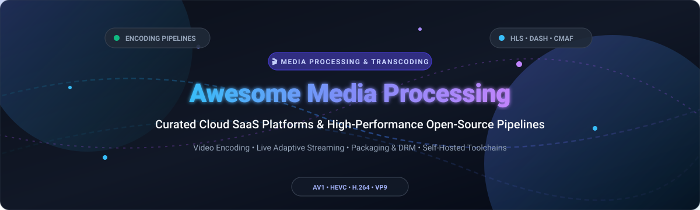

  

# 🎬 Awesome Media Processing & Transcoding

  
  
  
  
  
  
  

---

## 🚀 Top Media Processing, Transcoding & Video Pipeline Ecosystem

> ⚡ **A definitive, SEO-optimized, community-curated directory of enterprise SaaS transcoding APIs, cloud encoding engines, and high-performance open-source media frameworks.**  
> *Targeting video engineers, live-streaming developers, OTT infrastructure architects, and media pipeline builders.*

**Keywords / Topics**: `video transcoding`, `media processing`, `video encoding`, `ffmpeg`, `hls`, `dash`, `cmaf`, `av1`, `hevc`, `adaptive bitrate streaming`, `live streaming`, `drm`, `open-source transcoding`, `audio normalization`.

**📅 Last updated: October 2026**

---

## 📑 Table of Contents
- [🌐 Sector Overview & Market Dynamics](#-sector-overview--market-dynamics)
- [☁️ SaaS & Hosted Video Transcoding Platforms](#️-saas--hosted-video-transcoding-platforms)
- [💻 Open-Source GitHub Projects](#-open-source-github-projects)
- [🤝 How to Contribute](#-how-to-contribute)
- [💖 Support & Sponsorship](#-support--sponsorship)
- [⭐ Star History](#-star-history)
- [⚠️ Disclaimer](#️-disclaimer)

---

## 🌐 Sector Overview & Market Dynamics

The global **video transcoding and video processing platform market** is currently valued at approximately **$2.5B – $8.5B** and is projected to expand rapidly beyond **$19B – $22B+ by 2034**, clocking an impressive compound annual growth rate (**CAGR of ~10.6% – 11.3%**). 

The sector exhibits **moderate fragmentation with strong foundational concentration**: while massive hyperscalers (e.g., AWS Elemental MediaConvert) and specialized public giants (e.g., Dolby) anchor global broadcast-grade workflows, high customer agility and specialized developer needs have spawned high-growth independent video API unicorns (e.g., Cloudinary, Mux, Bitmovin). Concurrently, almost all commercial proprietary and cloud solutions depend on ubiquitous, non-winner-take-all open-source foundations anchored by **FFmpeg**.

---

## ☁️ SaaS & Hosted Video Transcoding Platforms

| Product | Description | Company Size (Valuation / Market Cap / Revenue) | Pricing | Free Tier Limit |
| :--- | :--- | :--- | :--- | :--- |
| **[AWS Elemental MediaConvert](https://aws.amazon.com/mediaconvert/)** | Broadcast-grade, file-based video transcoding with DRM, multi-format output, and audio processing. | **~$2.7T Market Cap** / ~$717B Rev (Amazon) | **Basic tier**: from **$0.0075/normalized minute** (first 100K/month); **Professional tier**: from **$0.015/normalized minute** (first 50K/month). Multipliers apply by resolution, codec, and frame rate. | **30-day free trial** via AWS Free Tier ($200 promotional credits on new accounts). MediaConvert itself has no permanent recurring free tier. |
| **[Dolby.io Media](https://dolby.io/)** | High-fidelity media processing APIs for enhancement, audio mastering, noise reduction, and transcoding. | **~$5.7B Market Cap** / ~$1.35B Rev (Dolby Laboratories) | Starting at **$0.05/minute** for media processing APIs; interactive streaming from $0.0025/participant-minute. | **200 processing minutes/month free forever** for Media Processing APIs, plus 50 GB/month real-time streaming bandwidth. |
| **[Cloudinary](https://cloudinary.com/)** | End-to-end media experience platform with dynamic image/video transformations, responsive breakpoints, and CDN delivery. | **~$2B Valuation** / ~$100M+ ARR | **Plus plan**: starting at **$89/month** (annual) or **$99/month** (monthly) for 225 credits; Advanced plan from $249/month. | **25 credits/month free forever** (usable for up to 25,000 transformations, 25 GB managed storage, or 25 GB bandwidth; max 100 MB video file size). |
| **[Mux](https://www.mux.com/)** | Developer-first video streaming and encoding API with instant per-title encoding and real-time playback analytics. | **~$1B Valuation** / ~$46M ARR | **Pay-as-you-go**: Basic encoding is **$0.00/min**; Plus encoding starts at **$0.025/min**; storage from **$0.0024/min/month**; delivery from **$0.0008/min**. | **Free plan forever**: includes **100,000 delivery minutes/month**, storage for up to 10 on-demand videos, and $20 initial usage credit. |
| **[Brightcove Zencoder](https://www.brightcove.com/)** | High-throughput cloud video encoding API built for large-scale media publishers and VOD libraries. | **~$233M Acquisition Valuation** / ~$190M Rev (Brightcove) | **Pay-as-you-go**: starts at **$0.05/minute** of output video; monthly subscription volume tiers drop to **$0.02/minute**. | **Free integration trial**: full File Transcoding API access with test job limits and API rate caps for development and testing. |
| **[Telestream Cloud](https://www.telestream.net/)** | Enterprise-grade cloud transcoding, automated quality control (QC), and Timed Text captioning services. | **~$150M–$200M+ Est. Rev** (PE-backed by Genstar Capital) | **Telestream Cloud Flip**: pay-as-you-go starting tier from **$0.01/minute** base encoding, scaling by resolution/codecs. | **30-day free trial** with **$100–$200 in free usage credits** to test transcoding pipelines. |
| **[Bitmovin](https://bitmovin.com/)** | High-speed cloud distributed encoding, cross-device HTML5 player, and video analytics infrastructure. | **~$100M–$200M Est. Valuation** / ~$22M ARR | **Starter pay-as-you-go**: **$0.02/additional minute** for baseline SD encoding beyond monthly free quota; Enterprise plans from $50,000/year. | **2,000 encoding minutes/month free forever**, plus 10,000 player impressions and 100,000 analytics impressions; includes 30-day trial. |
| **[Wowza Transcoder](https://www.wowza.com/)** | Live streaming and real-time ingest engine with adaptive bitrate (ABR) transcoding capabilities. | **~$15M–$30M Est. Rev** (PE-backed by Clearhaven Partners) | **Wowza Streaming Engine**: from **$195/month** (annual) or **$225/month** (monthly) per instance; cloud pay-as-you-go from **$1.50/hour**. | **30-day free trial** for Wowza Streaming Engine with full transcoding feature evaluation. No permanent free tier. |

---

## 💻 Open-Source GitHub Projects

*Ranked strictly by GitHub stargazers count (descending).*

- **[OBS Studio](https://github.com/obsproject/obs-studio)**   
  🎥 **Live Video Production & Real-Time Encoding.** Free and open-source software for video recording and live streaming. Features real-time source and device capture, scene composition, encoding via hardware engines (NVENC, AMD AMF, Intel QuickSync), audio mixing, and live streaming output across RTMP, SRT, and WebRTC protocols.

- **[FFmpeg](https://github.com/FFmpeg/FFmpeg)**   
  ⚡ **The Foundational Multimedia Engine.** The industry standard cross-platform solution to record, convert, transcode, mux, demux, stream, filter, and play almost any media format. Powers virtually every commercial transcoding service and video pipeline worldwide.

- **[Jellyfin](https://github.com/jellyfin/jellyfin)**   
  🍿 **Self-Hosted Media Server with On-The-Fly Transcoding.** The volunteer-built media system that puts you in control of managing and streaming media. Features dynamic on-demand transcoding using hardware acceleration (VA-API, NVENC, QSV) to adjust media resolution and bitrates dynamically for any client device.

- **[LosslessCut](https://github.com/mifi/lossless-cut)**   
  ✂️ **Ultrafast Lossless Video & Audio Trimming.** The swiss army knife for lossless trimming, cutting, and slicing of video and audio files without re-encoding or losing quality, powered directly by Chromium and FFmpeg.

- **[HandBrake](https://github.com/HandBrake/HandBrake)**   
  🎛️ **The Preset-Driven Open-Source Video Transcoder.** An opinionated, multiplatform video transcoder supporting multi-pass encoding, AV1, HEVC, H.264, and community-tuned hardware presets for batch conversion workflows.

- **[Streamlink](https://github.com/streamlink/streamlink)**   
  📡 **Live Stream Pipe & Extract Utility.** Command-line utility that extracts live video streams from various services and pipes them into a custom video player or media processing pipeline.

- **[FFmpeg-Builds](https://github.com/BtbN/FFmpeg-Builds)**   
  📦 **Automated Bleeding-Edge FFmpeg CI Builds.** Daily and release automated builds of FFmpeg with full hardware acceleration libraries enabled for Linux and Windows.

- **[OpenH264](https://github.com/cisco/openh264)**   
  🛡️ **Cisco's H.264 / AVC Codec Library.** Open-source codec library that supports H.264 encoding and decoding for real-time video communications, WebRTC applications, and low-latency streaming.

- **[Ant Media Server](https://github.com/ant-media/Ant-Media-Server)**   
  🛰️ **Sub-Second Real-Time WebRTC Streaming & Transcoding.** Ultra-low latency streaming engine supporting WebRTC (~0.5s), CMAF, HLS, RTMP, and adaptive bitrate transcoding.

- **[Tdarr](https://github.com/HaveAGitGat/Tdarr)**   
  🤖 **Distributed Media Transcode Automation.** An automated transcode processing engine that coordinates distributed worker nodes across Windows, macOS, Linux, and Docker using FFmpeg and HandBrake.

- **[rav1e](https://github.com/xiph/rav1e)**   
  ⚡ **The Fast and Safe AV1 Encoder.** The cleanest and fastest AV1 encoder written from scratch in Rust, backed by the Xiph.Org Foundation and Alliance for Open Media (AOMedia).

- **[VidGear](https://github.com/abhiTronix/vidgear)**   
  🐍 **High-Performance Video Processing Python Framework.** Wraps FFmpeg and OpenCV with an ultra-lightweight, multi-threaded API for real-time video capture, transcoding, streaming, and computer vision pipelines.

- **[GPAC](https://github.com/gpac/gpac)**   
  🧩 **Modular Multimedia Framework & MP4Box.** An advanced multimedia open-source framework featuring MP4Box for packaging, inspecting, and segmenting DASH/HLS streams and custom filtering pipelines.

- **[Shaka Packager](https://github.com/shaka-project/shaka-packager)**   
  🔒 **DASH, HLS & DRM Media Packaging Engine.** Google's media packaging toolkit for encrypting and preparing VOD and live content for adaptive bitrate streaming with Widevine, PlayReady, and FairPlay DRM support.

- **[Unmanic](https://github.com/Unmanic/unmanic)**   
  🔄 **Automated Music & Video Library Transcoder.** Post-processor transcode manager that detects video files, extracts audio, removes unwanted audio tracks, and encodes videos to modern standards automatically.

- **[Video Transcoding (Lisa Melton)](https://github.com/lisamelton/video_transcoding)**   
  🛠️ **CLI Video Transcoding Scripts & Presets.** Curated command-line utilities and batch scripts built on FFmpeg and HandBrake to transcode video collections into high-quality, lightweight MP4/MKV assets.

- **[libavif](https://github.com/AOMediaCodec/libavif)**   
  🖼️ **AV1 Image File Format (AVIF) Reference Library.** Portable C implementation of the AVIF image file format supporting still images, sequences, and alpha transparency encoding.

- **[BMF (BabitMF)](https://github.com/BabitMF/bmf)**   
  🚀 **GPU-Accelerated Multimodal Video Processing Engine.** ByteDance's cross-platform, modular video processing framework with heterogeneous GPU acceleration, multi-language bindings (C++, Python, Go), and AI inference integration.

---

## 🤝 How to Contribute

1. 🍴 **Fork the repo**.
2. 📝 **Add or edit entries in `README.md`** (follow standard table or badge format).
3. 🔎 **Include**: official link, concise 1–2 sentence description, and verify all numbers/features.
4. 🚀 **Submit a Pull Request** with a brief summary of the changes.

---

## 💖 Support & Sponsorship

If this curated repository saved you hours of research or helps streamline your video engineering pipeline, consider showing some love:

- ⭐ **Star this repository** on GitHub to keep it visible for fellow engineers.
- 🍴 **Fork and share** it with your developer community, colleagues, and team channels.
- ☕ **Buy a coffee or sponsor ongoing maintenance**: [Sponsor Dashboard on GitHub](https://github.com/sponsors/ishandutta2007)

Thank you for being part of the open media processing ecosystem! 🙌

---

## ⭐ Star History

---

## ⚠️ Disclaimer

- 📌 This is a **community-curated** list — not exhaustive and not a commercial endorsement.
- 💡 **SaaS pricing is dynamic & multiplier-based**: MediaConvert charges by normalized minutes with multipliers up to 40x+ for 4K HEVC; Bitmovin and Mux offer generous free tiers but scale with usage. Always model your actual resolution and codec mix before committing.
- ⚙️ **FFmpeg is the engine, not a product**: most commercial services and open-source wrappers depend on FFmpeg internally. Mastering FFmpeg CLI flags and filters pays dividends across the entire media stack.
- 📦 **Packaging is distinct from transcoding**: Shaka Packager and MP4Box prepare already-encoded content for streaming (manifests, DRM, segmentation). They do not encode—pair them with FFmpeg or HandBrake.

---

  <b>Built for video engineers, streaming architects, and developers building scalable media pipelines. 🎥✨</b>

